<p align="center">
  <picture>
    <source media="(prefers-color-scheme: dark)" srcset="docs/assets/logo/dist/actual-mcp-horizontal-dark.svg">
    <source media="(prefers-color-scheme: light)" srcset="docs/assets/logo/dist/actual-mcp-horizontal.svg">
    
  </picture>
</p>

# actual-mcp

<p align="center">
  <a href="https://github.com/PedroLiu1999/actual-mcp/actions/workflows/ci.yml"></a>
  <a href="https://github.com/PedroLiu1999/actual-mcp/actions/workflows/docker-publish.yml"></a>
  <a href="https://github.com/PedroLiu1999/actual-mcp/releases"></a>
  <a href="https://nodejs.org/"></a>
  <a href="https://modelcontextprotocol.io/"></a>
</p>

A self-contained Model Context Protocol (MCP) server that connects a self-hosted [Actual Budget](https://actualbudget.org/) instance to **AI assistants (Claude Desktop, Cursor, Google Gemini, and custom agents)** over **Streamable HTTP** (`POST /mcp`) and an **Embedded OAuth Server** (OAuth 2.1 Public Client + PKCE).

Designed for single-user VPS deployments where `actual-server` and `cloudflared` (Cloudflare Tunnel) are already running, `actual-mcp` packages the `@actual-app/api` (`loot-core`) Node.js engine, a persistent local SQLite **Budget Cache**, and a zero-dependency **Embedded OAuth Server** into a single lightweight Docker container.

---

## Architecture



<details>
<summary>ASCII Diagram Fallback</summary>

```text
+------------------------+        HTTPS (Cloudflare Tunnel)        +---------------------------------------------------+
|  AI Assistant / Client |  ------------------------------------>  |               actual-mcp (Docker)                 |
| (Claude, Cursor, etc.) |     POST /mcp (Bearer Access Token)     |                                                   |
|                        |     GET  /.well-known/oauth-*           |  +---------------------------------------------+  |
|                        |     GET/POST /authorize, POST /token    |  | Embedded OAuth Server (OAuth 2.1 + PKCE)    |  |
+------------------------+                                         |  | - Public Client (no client secrets needed)  |  |
                                                                   |  | - Dynamic client_id acceptance              |  |
                                                                   |  | - Passphrase-protected HTML consent screen  |  |
                                                                   |  | - Persistent Token Store (oauth-tokens.json)|  |
                                                                   |  +---------------------------------------------+  |
                                                                   |                        |                          |
                                                                   |                        v                          |
                                                                   |  +---------------------------------------------+  |
                                                                   |  | Stateless Streamable HTTP Transport (/mcp)  |  |
                                                                   |  | - 39 MCP Tools (11 Read, 28 Write)          |  |
                                                                   |  | - Decimal Amount <-> Minor Unit conversion  |  |
                                                                   |  +---------------------------------------------+  |
                                                                   |                        |                          |
                                                                   |                        v                          |
                                                                   |  +---------------------------------------------+  |
                                                                   |  | ActualBudgetGateway (FIFO Mutex)            |  |
                                                                   |  | - Coalesced Sync (TTL on reads, pre/post    |  |
                                                                   |  |   sync on writes, graceful SIGTERM drain)   |  |
                                                                   |  | - Local SQLite Budget Cache (/data)         |  |
                                                                   |  +---------------------------------------------+  |
                                                                   +------------------------|--------------------------+
                                                                                            |
                                                                                            | HTTP (host.docker.internal:5006)
                                                                                            v
                                                                   +---------------------------------------------------+
                                                                   |       Existing Actual Budget Sync Server          |
                                                                   |            (actualbudget/actual-server)           |
                                                                   +---------------------------------------------------+
```

</details>

### Key Design Highlights

1. **Embedded Single-Tenant OAuth 2.1 Server ([ADR-0006](docs/adr/0006-public-client-pkce-oauth.md))**:
   - Exposes RFC 9728 Protected Resource Metadata (`/.well-known/oauth-protected-resource` and `/.well-known/oauth-protected-resource/mcp`) and RFC 8414 Authorization Server Metadata (`/.well-known/oauth-authorization-server`).
   - Zero client credentials required: implements OAuth 2.1 Public Client (`token_endpoint_auth_methods_supported: ['none']`) with PKCE (`S256`).
   - Dynamically accepts any incoming `client_id` without requiring an RFC 7591 registration endpoint.
   - Enforces an explicit redirect URI allowlist in `.env` (`OAUTH_ALLOWED_REDIRECT_URIS`), supporting loopback port relaxation for `localhost` and `127.0.0.1` per RFC 8252 §7.3 while enforcing exact matching on remote HTTPS URIs.
   - Renders a self-contained, rate-limited HTML consent screen at `GET /authorize` gated by `OAUTH_ADMIN_PASSWORD`.
   - Implements **Persistent Linking** via a file-backed **Token Store** (`/data/oauth-tokens.json`): `grant_type=refresh_token` returns a fresh access token while preserving the exact same refresh token and extending its sliding 365-day expiration so your AI link survives token refreshes and container restarts.
2. **Single-Budget FIFO Mutex & Coalesced Sync ([ADR-0002](docs/adr/0002-single-budget-mutex-and-cache.md))**:
   - `@actual-app/api` embeds `loot-core` and a module-level `better-sqlite3` singleton. `actual-mcp` binds to a single **Target Budget** (`ACTUAL_SYNC_ID`), caches its SQLite database in `/data/budget-cache`, and serializes every API operation through a process-wide non-reentrant FIFO mutex.
   - **Coalesced Sync**: Read operations skip `api.sync()` if the **Budget Cache** was synced within `SYNC_TTL_SECONDS` (default `30` seconds, overrideable per call with `forceSync: true`). Write operations always `sync()` before mutating and `sync()` immediately after mutating so changes reach the **Sync Server** before the tool returns.
   - **Graceful Shutdown**: Running under `tini` (PID 1), `SIGTERM` and `SIGINT` drain any in-flight mutex operation, run a final `sync()`, and cleanly close the SQLite database via `shutdown()`.
3. **Decimal Amounts at the MCP Boundary**:
   - Internally, `@actual-app/api` represents money as integer **Minor Unit Amounts** (`-1234` for `-$12.34`). Every MCP tool in `actual-mcp` accepts and returns standard major-unit **Decimal Amounts** (`-12.34` for a `$12.34` **Outflow** / expense, `100.00` for a `$100.00` **Inflow** / income) to prevent LLM unit-scale errors.

---

## MCP Tools Reference (all 39 MCP tools & extended lifecycle capabilities)

`actual-mcp` v0.3.0 documents and provides all 39 MCP tools (11 read, 28 write across Categories, Category Groups, Payees, Accounts, Bank Sync, Budget Adjustments, Recurring Schedules, and Automation Rules). All tools return structured JSON serialized in MCP text content blocks and include MCP safety annotations (`readOnlyHint`, `destructiveHint`).

### Read Tools (`readOnlyHint: true`, `destructiveHint: false`)

| Tool | Description | Parameters |
| :--- | :--- | :--- |
| `list_accounts` | List all accounts in the **Target Budget** with ID, name, `offbudget` flag, `closed` flag, and current balance as a **Decimal Amount**. | `forceSync?` (`boolean`) |
| `get_transactions` | Query transactions with enriched `accountName`, `categoryName`, and `payeeName` alongside IDs and **Decimal Amounts**. | `accountId?` (`string`), `startDate?` (`YYYY-MM-DD`), `endDate?` (`YYYY-MM-DD`), `categoryId?` (`string`), `payeeId?` (`string`), `searchText?` (`string`, case-insensitive match on payee/notes), `limit?` (`1..500`, default `100`), `forceSync?` (`boolean`) |
| `get_spending_summary` | Aggregate transactions over a date range into a **Spending Summary** grouped by `'category'`, `'payee'`, or `'month'` with split transactions inlined (`splits: 'inline'`). Excludes internal transfers and off-budget accounts by default. | `startDate` (`YYYY-MM-DD`, required), `endDate` (`YYYY-MM-DD`, required), `groupBy?` (`'category' \| 'payee' \| 'month'`, default `'category'`), `includeTransfers?` (`boolean`, default `false`), `includeOffBudget?` (`boolean`, default `false`), `forceSync?` (`boolean`) |
| `run_aql_query` | Execute a Zod-validated, read-only **Structured AQL Query** against `@actual-app/api`'s `q(table)` builder and `aqlQuery()`, converting monetary fields to **Decimal Amounts**. | `table` (`'transactions' \| 'accounts' \| 'categories' \| 'category_groups' \| 'payees' \| 'schedules' \| 'rules'`), `filter?` (`object`), `select?` (`string \| Array<string \| object>`), `groupBy?` (`string \| string[]`), `orderBy?` (`string \| object \| Array`), `limit?` (`1..1000`, default `100`), `offset?` (`number`), `splits?` (`'inline' \| 'grouped' \| 'all'`, default `'inline'`), `forceSync?` (`boolean`) |
| `list_categories` | List all category groups and their categories (`id`, `name`, `group_id`, `is_income`, `hidden`). | `forceSync?` (`boolean`) |
| `list_payees` | List all payees (`id`, `name`, `transfer_acct`). | `forceSync?` (`boolean`) |
| `list_budget_months` | List available `YYYY-MM` **Budget Months** in the **Target Budget**. | `forceSync?` (`boolean`) |
| `get_budget_month` | Inspect a `YYYY-MM` **Budget Month** envelope summary (`toBudget`, `totalIncome`, `totalBudgeted`, `totalSpent`, `totalBalance`, and per-category `budgeted`, `spent`, `balance`, `carryover` in **Decimal Amounts**). | `month` (`YYYY-MM`, required), `forceSync?` (`boolean`) |
| `list_schedules` | List all recurring schedules in the **Target Budget** with ID, name, rule ID, next date, completed flag, posts transaction flag, payee ID, account ID, **Decimal Amount**, amount operator, and recurrence date config. | `forceSync?` (`boolean`) |
| `get_schedule_upcoming_dates` | Calculate upcoming occurrence dates for a schedule ID or date recurrence config over a given date range or count. | `scheduleId?` (`string`), `date?` (`string \| object`), `start?` (`YYYY-MM-DD`), `end?` (`YYYY-MM-DD`), `count?` (`number`, 1..100, default 10), `forceSync?` (`boolean`) |
| `list_rules` | List all automation/categorization rules in the **Target Budget** with conditions, actions, stage, and operator, with optional payee filtering. Amounts in conditions and actions are converted to **Decimal Amounts**. | `payeeId?` (`string`), `forceSync?` (`boolean`) |

### Write & Lifecycle Tools (`readOnlyHint: false`)

#### Transactions & Budget Amounts (Core v0.1.0)

| Tool | Destructive | Description | Parameters |
| :--- | :---: | :--- | :--- |
| `create_transactions` | `false` | Create a batch of 1 to 50 transactions in an account using **Decimal Amounts**. Uses `importTransactions` by default (`runRules: true`) so payee matching/creation and Actual categorization rules run automatically, or `addTransactions` when `runRules: false`. | `accountId` (`string`, required), `transactions` (`Array<{ date, amount, payeeName?, payeeId?, categoryId?, notes?, cleared?, importedId? }>`, 1–50 items), `runRules?` (`boolean`, default `true`) |
| `update_transaction` | `false` | Update an existing transaction by ID and return `{ previous, updated }` in **Decimal Amounts** so edits can be verified or immediately reverted. | `id` (`string`, required), `date?` (`YYYY-MM-DD`), `amount?` (`number`), `payeeId?` (`string \| null`), `categoryId?` (`string \| null`), `notes?` (`string \| null`), `cleared?` (`boolean`) |
| `delete_transaction` | `true` | Delete an existing transaction by ID and return `{ deleted }` containing the full pre-deletion record in **Decimal Amounts** so it can be recreated if deleted by mistake. | `id` (`string`, required) |
| `set_budget_amount` | `false` | Update a category's budgeted **Decimal Amount** and/or overspending `carryover` flag in a `YYYY-MM` **Budget Month** and return `{ previous, updated }` category states. | `month` (`YYYY-MM`, required), `categoryId` (`string`, required), `budgeted?` (`number`), `carryover?` (`boolean`) |

#### Category & Category Group Management (v0.2.0)

| Tool | Destructive | Description | Parameters |
| :--- | :---: | :--- | :--- |
| `create_category` | `false` | Create a new envelope category under an existing category group. Returns `{ id }`. | `name` (`string`, min 1, required), `groupId` (`string`, min 1, required), `isIncome?` (`boolean`), `hidden?` (`boolean`) |
| `update_category` | `false` | Update an existing envelope category (rename, move to a different parent group, toggle income/hidden flags). | `id` (`string`, min 1, required), `name?` (`string`), `groupId?` (`string`), `isIncome?` (`boolean`), `hidden?` (`boolean`) |
| `delete_category` | `true` | Delete an existing envelope category. If the category has existing transactions, `transferCategoryId` must be provided to reassign them without orphaned records. | `id` (`string`, min 1, required), `transferCategoryId?` (`string`, min 1) |
| `create_category_group` | `false` | Create a new category group to organize related expense or income envelopes. Returns `{ id }`. | `name` (`string`, min 1, required), `isIncome?` (`boolean`), `hidden?` (`boolean`) |
| `update_category_group` | `false` | Update an existing category group (rename or toggle income/hidden flags). | `id` (`string`, min 1, required), `name?` (`string`), `isIncome?` (`boolean`), `hidden?` (`boolean`) |
| `delete_category_group` | `true` | Delete an existing category group. If any member categories have transactions, `transferCategoryId` must be provided to safely reassign them. | `id` (`string`, min 1, required), `transferCategoryId?` (`string`, min 1) |

#### Payee Management & Merging (v0.2.0)

| Tool | Destructive | Description | Parameters |
| :--- | :---: | :--- | :--- |
| `create_payee` | `false` | Create a new payee record with a name string and return its generated ID `{ id }`. | `name` (`string`, min 1, required) |
| `update_payee` | `false` | Rename an existing payee record. | `id` (`string`, min 1, required), `name` (`string`, min 1, required) |
| `delete_payee` | `true` | Delete an existing payee record. | `id` (`string`, min 1, required) |
| `merge_payees` | `true` | Merge one or more duplicate source payees into a canonical target payee, consolidating all transactions and rules under the target payee and removing source records. | `targetPayeeId` (`string`, min 1, required), `sourcePayeeIds` (`string[]`, min 1 items, required) |

#### Account Lifecycle Management (v0.2.0)

| Tool | Destructive | Description | Parameters |
| :--- | :---: | :--- | :--- |
| `create_account` | `false` | Create a new on-budget or off-budget account with a specified type and optional initial balance in **Decimal Amount**. Returns `{ id }`. | `name` (`string`, min 1, required), `type` (`'checking' \| 'savings' \| 'credit' \| 'investment' \| 'mortgage' \| 'debt' \| 'other'`, required), `offbudget?` (`boolean`), `initialBalance?` (`number`, finite Decimal Amount) |
| `update_account` | `false` | Update an existing account name or toggle its off-budget status. | `id` (`string`, min 1, required), `name?` (`string`), `offbudget?` (`boolean`) |
| `close_account` | `true` | Close an account in the Target Budget, optionally transferring remaining balance to another account and category. | `id` (`string`, min 1, required), `transferAccountId?` (`string`), `transferCategoryId?` (`string`) |
| `reopen_account` | `false` | Reopen a previously closed account. | `id` (`string`, min 1, required) |

#### Bank Synchronization (v0.2.0)

| Tool | Destructive | Description | Parameters |
| :--- | :---: | :--- | :--- |
| `run_bank_sync` | `false` | Trigger bank synchronization for a specific linked account or all linked accounts when `accountId` is omitted. Returns structured reconciliation summary `{ updatedAccountIds, newTransactionsCount, matchedTransactionsCount, errors }`. | `accountId?` (`string`, min 1) |

#### Budget Flow Adjustments (v0.2.0)

| Tool | Destructive | Description | Parameters |
| :--- | :---: | :--- | :--- |
| `set_budget_carryover` | `false` | Set the carryover flag for a category envelope in a specified budget month (`YYYY-MM`). When true, overspent category balance rolls over into the next month. | `month` (`YYYY-MM`, required), `categoryId` (`string`, min 1, required), `carryover` (`boolean`, required) |
| `hold_budget_for_next_month` | `false` | Hold a specified **Decimal Amount** from the current month available budget for next month. | `month` (`YYYY-MM`, required), `amount` (`number`, finite Decimal Amount, required) |
| `reset_budget_hold` | `false` | Reset the budget hold for a given month, releasing held budget hold funds back to the current month available budget. | `month` (`YYYY-MM`, required) |

#### Recurring Schedules Suite (v0.3.0)

| Tool | Destructive | Description | Parameters |
| :--- | :---: | :--- | :--- |
| `create_schedule` | `false` | Create a recurring schedule in the Target Budget with **Decimal Amounts**, recurrence configuration, and linked payee/account. | `name?` (`string`), `account` (`string`, required), `payee?` (`string`), `amount` (`number \| { num1, num2 }`, Decimal Amount, required), `amountOp?` (`'is' \| 'isapprox' \| 'isbetween'`), `date` (`string \| object`, required), `posts_transaction?` (`boolean`) |
| `update_schedule` | `false` | Update fields on an existing recurring schedule (name, amount as Decimal Amount, amountOp, payee, account, date, posts_transaction, resetNextDate). | `id` (`string`, required), `name?` (`string`), `account?` (`string`), `payee?` (`string \| null`), `amount?` (`number \| { num1, num2 }`), `amountOp?` (`'is' \| 'isapprox' \| 'isbetween'`), `date?` (`string \| object`), `posts_transaction?` (`boolean`), `resetNextDate?` (`boolean`) |
| `delete_schedule` | `true` | Permanently delete a recurring schedule from the Target Budget. | `id` (`string`, required) |

#### Automation Rules Suite (v0.3.0)

| Tool | Destructive | Description | Parameters |
| :--- | :---: | :--- | :--- |
| `create_rule` | `false` | Create a new automation rule for categorization, payee renaming, or field setting. Converts any monetary condition/action values from **Decimal Amounts** to Minor Units. | `stage?` (`'pre' \| 'post' \| 'default'`), `conditionsOp?` (`'and' \| 'or'`), `conditions` (`Array<{ field, op, value, options? }>`, min 1, required), `actions` (`Array<{ field?, op, value?, options? }>`, min 1, required) |
| `update_rule` | `false` | Update conditions, actions, stage, or conditionsOp for an existing automation rule by ID. | `id` (`string`, required), `stage?` (`'pre' \| 'post' \| 'default'`), `conditionsOp?` (`'and' \| 'or'`), `conditions` (`Array<{ field, op, value, options? }>`, min 1, required), `actions` (`Array<{ field?, op, value?, options? }>`, min 1, required) |
| `delete_rule` | `true` | Permanently delete an automation rule from the Target Budget. | `id` (`string`, required) |

---

## Quick Start (One-Command Setup)

Deploy in seconds on your VPS without cloning the repository. In your terminal, run:

```bash
mkdir -p actual-mcp && cd actual-mcp && bash -c "$(curl -fsSL https://raw.githubusercontent.com/PedroLiu1999/actual-mcp/main/scripts/setup-wizard.sh)"
```

The interactive wizard handles everything end-to-end:
1. **Auto-Downloads `docker-compose.yml`**: Fetches the compose file and creates the persistent `data/` directory.
2. **Configures `.env`**: Sets up `PUBLIC_URL` (for your Cloudflare Tunnel) and loopback `PORT` (default `3000`).
3. **OAuth Configuration**: Prompts for `OAUTH_ADMIN_PASSWORD` (Admin Consent Passphrase) and configures allowed redirect URIs.
4. **Actual Budget Connection**: Prompts for `ACTUAL_SERVER_URL`, server password, and `ACTUAL_SYNC_ID`.
5. **Starts Docker Container**: Offers to pull the pre-built image from GHCR and start it (`docker compose pull && docker compose up -d`).
6. **Healthchecks**: Tests local and public `/healthz` endpoints.
7. **Connect AI Client**: Displays the exact `MCP server URL` (`${PUBLIC_URL}/mcp`) to paste into your AI assistant.

---

## Environment Variables

Copy `.env.example` to `.env` (or run `./scripts/setup-wizard.sh`):

| Variable | Required | Default | Description |
| :--- | :---: | :--- | :--- |
| `PUBLIC_URL` | **Yes** | — | Public HTTPS origin exposed by your Cloudflare Tunnel (e.g. `https://actual-mcp.example.com`, no trailing slash). |
| `PORT` | No | `3000` | Port the HTTP server listens on inside the container (and host loopback port in `docker-compose.yml`). |
| `ACTUAL_MCP_VERSION` | No | `latest` | Tag of the pre-built Docker image from GitHub Container Registry (`ghcr.io/pedroliu1999/actual-mcp`). |
| `DATA_DIR` | **Yes** | `/data` | Path to the persistent directory storing `oauth-tokens.json` (**Token Store**) and `budget-cache/` (**Budget Cache**). |
| `OAUTH_ADMIN_PASSWORD` | **Yes** | — | Admin passphrase required on the HTML consent page (`GET /authorize`) to approve an OAuth grant. |
| `OAUTH_ALLOWED_REDIRECT_URIS` | No | `http://localhost,http://127.0.0.1` | Comma-separated list of allowed OAuth redirect URIs. Loopback ports match automatically per RFC 8252. |
| `ACTUAL_SERVER_URL` | **Yes** | — | URL of your self-hosted Actual Budget **Sync Server** (e.g. `http://host.docker.internal:5006`). |
| `ACTUAL_PASSWORD` | **Yes** | — | Server password used to sign in to your Actual Budget **Sync Server**. |
| `ACTUAL_SYNC_ID` | **Yes** | — | **Sync ID** UUID of the **Target Budget** (found in Actual Budget under *Settings → Show advanced settings → Sync ID*). |
| `ACTUAL_ENCRYPTION_PASSWORD` | No | — | End-to-end encryption password for the **Target Budget** (omit or leave empty if unencrypted). |
| `SYNC_TTL_SECONDS` | No | `30` | **Coalesced Sync** freshness window in seconds for read tools. |

---

## VPS Deployment Guide

This guide assumes your VPS already runs:
1. An Actual Budget **Sync Server** (`actual-server`, typically listening on port `5006`).
2. A Cloudflare Tunnel (`cloudflared`).

### Step 1: Clone & Configure `.env`

```bash
git clone git@github.com:PedroLiu1999/actual-mcp.git
cd actual-mcp
mkdir -p data
```

You can configure `.env` interactively using the setup wizard:

```bash
./scripts/setup-wizard.sh
```

Or configure it manually by copying `.env.example`:

```bash
cp .env.example .env
```

Set `OAUTH_ADMIN_PASSWORD` to a strong passphrase, and fill in your `.env`:

- Set `PUBLIC_URL=https://actual-mcp.yourdomain.com` (matching the hostname you will route in `cloudflared`).
- Set `ACTUAL_SERVER_URL`:
  - If `actual-server` publishes port `5006` on the VPS host (e.g. `127.0.0.1:5006:5006` or `0.0.0.0:5006:5006`), keep `ACTUAL_SERVER_URL=http://host.docker.internal:5006` (`docker-compose.yml` maps `host.docker.internal` to the Docker host gateway automatically).
  - If `actual-server` uses a self-signed certificate over HTTPS, either connect over local HTTP via `host.docker.internal` or mount the CA certificate and set `NODE_EXTRA_CA_CERTS`.
- Set `ACTUAL_PASSWORD` to your Actual server password and `ACTUAL_SYNC_ID` to your budget's **Sync ID** (*Settings → Show advanced settings → Sync ID* in the Actual UI).

### Step 2: Start the Container

To run using the official prebuilt image from GitHub Container Registry:

```bash
docker compose pull
docker compose up -d
```

Or build locally from source:

```bash
docker compose up -d --build
```

Verify the container is healthy and the **Target Budget** initialized cleanly:

```bash
curl -s http://127.0.0.1:3000/healthz | jq .
```

Expected response:

```json
{
  "status": "ok",
  "targetBudget": {
    "ready": true,
    "syncId": "11111111-2222-3333-4444-555555555555",
    "lastSyncedAt": "2026-11-04T18:00:00.000Z"
  }
}
```

### Step 3: Route a Public Hostname in Your Existing `cloudflared` Tunnel

Because `docker-compose.yml` binds `127.0.0.1:${PORT:-3000}:3000` on the VPS host, `actual-mcp` is never exposed directly on your VPS's public IP—only through your Cloudflare Tunnel.

#### Option A: Cloudflare Zero Trust Dashboard (Remotely Managed Tunnel)
1. Open the **Cloudflare Zero Trust Dashboard** → **Networks** → **Tunnels**.
2. Select your existing tunnel and click **Configure** → **Public Hostname** → **Add a public hostname**.
3. Set:
   - **Subdomain**: `actual-mcp` (or your chosen subdomain)
   - **Domain**: `yourdomain.com`
   - **Service Type**: `HTTP`
   - **URL**: `127.0.0.1:3000` (or `host.docker.internal:3000` if `cloudflared` runs inside a Docker container with `host-gateway` mapped)
4. Save the hostname.

#### Option B: Local `cloudflared` Config File (`/etc/cloudflared/config.yml`)
Add an ingress rule before the catch-all `http_status:404` rule:

```yaml
ingress:
  - hostname: actual-mcp.yourdomain.com
    service: http://127.0.0.1:3000
  # ... your existing ingress rules ...
  - service: http_status:404
```

Then create the DNS route and reload `cloudflared`:

```bash
cloudflared tunnel route dns <your-tunnel-name> actual-mcp.yourdomain.com
sudo systemctl restart cloudflared
```

> **Cloudflare WAF / Bot Fight Mode Note**: Google Gemini sends outbound MCP requests with `User-Agent: Google`. Ensure Cloudflare **Bot Fight Mode** or custom WAF rules on `actual-mcp.yourdomain.com` do not challenge (CAPTCHA / JS challenge) requests to `/mcp`, `/authorize`, `/token`, `/revoke`, or `/.well-known/*`.

Verify external OAuth discovery over HTTPS:

```bash
curl -s https://actual-mcp.yourdomain.com/.well-known/oauth-protected-resource | jq .
curl -s https://actual-mcp.yourdomain.com/.well-known/oauth-authorization-server | jq .
```

---

## Connecting in AI Assistants (Claude Desktop, Cursor, Gemini)

Once `https://actual-mcp.yourdomain.com` is live behind your Cloudflare Tunnel:

1. In your AI client (e.g. Claude Desktop, Cursor, or Gemini), add the MCP server URL:
   - **MCP server URL**: `https://actual-mcp.yourdomain.com/mcp`
2. **Zero Credentials Required**: Because `actual-mcp` implements OAuth 2.1 Public Client with PKCE, you do not need to configure or copy-paste any `Client ID` or `Client Secret`.
3. **Approval**:
   - The client discovers OAuth metadata and opens a browser window to `https://actual-mcp.yourdomain.com/authorize`.
   - On the **Authorize Actual Budget MCP** consent screen, enter your `OAUTH_ADMIN_PASSWORD` and click **Approve Access**.
4. The client exchanges the authorization code with PKCE (`S256`) and receives persistent tokens. Your Actual Budget tools are now ready to use!

---

## Local Development & Verification

Requires **Node.js `>=22.0.0`**.

```bash
# Install dependencies
npm install

# Run the test suite (Vitest)
npm test

# Run TypeScript typechecking
npm run typecheck

# Compile TypeScript to dist/
npm run build
```

### Continuous Integration (CI)

Automated GitHub Actions workflows run on every pull request and push to `main`:
- **CI Pipeline** ([`.github/workflows/ci.yml`](.github/workflows/ci.yml)): Runs dependency installation (`npm ci`), TypeScript typecheck (`npm run typecheck`), full Vitest test suite (`npm test`), and production compilation (`npm run build`) across supported Node.js versions (`22.x`, `24.x`).
- **Container Build & Publish** ([`.github/workflows/docker-publish.yml`](.github/workflows/docker-publish.yml)): Builds and pushes multi-architecture (`linux/amd64`, `linux/arm64`) Docker container images to GitHub Container Registry.

---

## Brand & Logo Assets

The official `actual-mcp` brand identity ("The Agent Spark") is available in [`docs/assets/logo/`](docs/assets/logo/):
- **Brand Guidelines**: [`docs/assets/logo/BRAND-GUIDELINES.md`](docs/assets/logo/BRAND-GUIDELINES.md)
- **Vector & Raster Distribution**: [`docs/assets/logo/dist/`](docs/assets/logo/dist/) (SVG masters, PNG ladders, PWA icons, favicon.ico)
- **Interactive Presentation Board**: [`docs/assets/logo/presentation.html`](docs/assets/logo/presentation.html)

